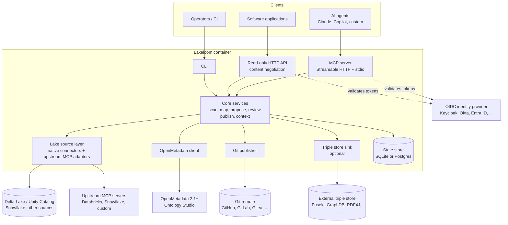

# Lakeloom

> **Status: pre-alpha, milestone M1 complete.** Not ready for production use.
>
> **M1 status:** M1 is complete: lake sources and scans (M1a), the semantic read path (M1b) and
> the publication surfaces (M1c: HTTP API, MCP resources, stdio, OpenTelemetry). Proposals,
> change sets and Git publishing arrive in M2; releases, SHACL shapes and the full JSON-LD
> context in M3.

Lakeloom is an open-source, agent-first service that lets AI agents and domain specialists build
and maintain **business ontologies for the data products in a Delta Lake** (and other
lakehouse/warehouse platforms).

- **OpenMetadata Ontology Studio is the ontology engine.** It stores concepts, relationships,
  attributes, axioms and mappings, and governs changes through change sets that a reviewer applies.
- **Lakeloom is the link** between the lake and that engine. It reads schemas and table metadata,
  turns them into proposed ontology changes, and serves the resulting semantics back to agents and
  applications.
- **Git is the version store.** Every applied change and release is written to a Git repository in
  standard semantic formats.
- **There is no UI.** The interface is an MCP server (for agents), a small read-only HTTP API (for
  software), and a CLI (for operators and CI).

## Architecture



## Quick start

Runs the full development stack locally: OpenMetadata 2.1.0-rc1 (M0 targets this release
candidate), Keycloak, Gitea, PostgreSQL and Lakeloom.

**Prerequisites:** a Docker-compatible engine with at least 8 GB of memory (Docker Engine,
OrbStack, Podman or Rancher Desktop) and [uv](https://docs.astral.sh/uv/) (only needed for
development and the tests).

```bash
git clone https://github.com/elcioabrahao/lakeloom
cd lakeloom
docker compose -f deploy/compose/docker-compose.yml up -d --wait   # first start takes several minutes
curl localhost:8000/readyz
```

`/readyz` returns HTTP 200 once Lakeloom can reach OpenMetadata, its database and its Git workspace.

| Service       | URL                     | Notes                  |
|---------------|-------------------------|------------------------|
| Lakeloom      | http://localhost:8000   | MCP at `/mcp`          |
| OpenMetadata  | http://localhost:8585   |                        |
| Keycloak      | http://localhost:8180   | realm `lakeloom`       |
| Gitea         | http://localhost:3000   |                        |
| PostgreSQL    | localhost:5432          |                        |

All ports are bound to `127.0.0.1` only.

> **Development only.** Every credential in the dev stack is a fixed, publicly known default
> (for example the Keycloak client secret `dev-agent-secret` and the OpenMetadata admin
> `admin@open-metadata.org` / `admin`). Never reuse them outside a local machine.

### Call a tool from an agent

Get an agent token from Keycloak (client `lakeloom-agent`, realm `lakeloom`):

```bash
TOKEN=$(curl -s http://localhost:8180/realms/lakeloom/protocol/openid-connect/token \
  -d grant_type=client_credentials -d client_id=lakeloom-agent \
  -d client_secret=dev-agent-secret | python3 -c 'import sys, json; print(json.load(sys.stdin)["access_token"])')
```

Register Lakeloom in Claude Code and ask it to call `get_server_info` (or `list_sources`):

```bash
claude mcp add --transport http lakeloom http://localhost:8000/mcp \
  --header "Authorization: Bearer $TOKEN"
```

Any other MCP client that supports Streamable HTTP works the same way: point it at
`http://localhost:8000/mcp` and send the bearer token. Tokens are short-lived; fetch a new one
when it expires.

### stdio transport (local use)

For a local client that launches the server itself (Claude Code, Claude Desktop), Lakeloom can
speak MCP over stdin/stdout. It is treated as the configured local principal
(`LAKELOOM_STDIO_PRINCIPAL`, default `local`, an agent) with only the scopes in
`LAKELOOM_STDIO_SCOPES` (JSON or comma list, default `lakeloom:read`); there is no bearer
token and no OIDC setup. It is disabled in production unless `LAKELOOM_STDIO_ENABLED=true`
(default on in development), and **the container image disables it**. `LAKELOOM_STDIO_SCOPES` may
grant any known scope, including `lakeloom:admin`: grant only what the local user should have. Logs go to stderr;
stdout carries only the protocol.

```bash
claude mcp add lakeloom \
  -e LAKELOOM_STDIO_ENABLED=true -e LAKELOOM_OM_URL=http://localhost:8585 \
  -e LAKELOOM_OM_BOT_TOKEN=... -e LAKELOOM_DB_URL=sqlite:////tmp/lakeloom.db \
  -- lakeloom serve --transport stdio
```

The same as a project `.mcp.json`:

```json
{
  "mcpServers": {
    "lakeloom": {
      "command": "lakeloom",
      "args": ["serve", "--transport", "stdio"],
      "env": {
        "LAKELOOM_STDIO_ENABLED": "true",
        "LAKELOOM_OM_URL": "http://localhost:8585",
        "LAKELOOM_OM_BOT_TOKEN": "...",
        "LAKELOOM_DB_URL": "sqlite:////tmp/lakeloom.db"
      }
    }
  }
}
```

### Lake sources and scans

Lake sources are configured by the operator in a YAML file named by `LAKELOOM_CONFIG_FILE`;
agents can only name a configured source, never add one or pass a URL. The dev stack mounts
[`deploy/compose/lakeloom-sources.yaml`](deploy/compose/lakeloom-sources.yaml) with three
sources over the same fixture lake (catalog `retail`, schema `sales`, four tables):

```yaml
sources:
  - type: delta                       # Delta tables read with delta-rs (extra `delta`)
    name: fixture_delta
    om_service: lakeloom_fixture      # OpenMetadata service used to look tables up
    tables:
      - {uri: "file:///lake/orders", catalog: retail, schema: sales}
      # ... customers, products, invoices
  - type: unity_catalog               # Unity Catalog REST API (OSS or Databricks)
    name: fixture_uc
    url: http://unitycatalog:8080
    catalogs: [retail]                # optional allow-list
    read_storage: true                # versions/profiles from the Delta log
    om_service: lakeloom_fixture
  - type: mcp                         # an upstream MCP server, bound by a mapping file
    name: openmetadata_mcp
    transport: streamable_http
    url: http://openmetadata-server:8585/mcp
    token_file: /secrets/om_bot_token # or token_env: VAR_NAME; never logged
    mapping: /etc/lakeloom/mappings/openmetadata.yaml
    om_service: lakeloom_fixture
```

Relative `mapping` and `token_file` paths resolve against the YAML file's directory. A
broken config stops startup with a configuration error; an unreachable upstream MCP server
does not: its source is reported `available: false` with an error code and hint, and the
next call at least 30 s after the last attempt reconnects.

Give an upstream MCP source a **read-only** token. Lakeloom only calls the mapped read
tools, but OpenMetadata's MCP server also exposes write tools (`create_entity`,
`patch_entity`, ...); in production use a dedicated OM bot whose role can only read. The
dev stack reuses OM's `ingestion-bot` token, which can write.

MCP tools: `list_sources`, `list_tables` (paginated with `cursor`/`limit`) and
`describe_table` need scope `lakeloom:read` and are read-only; `scan_lake_source` needs
`lakeloom:propose` and writes a scan record (tables, versions, OpenMetadata matches and
optional profiles). The same operations are on the CLI for operators:

```bash
docker compose -f deploy/compose/docker-compose.yml exec lakeloom lakeloom sources
docker compose -f deploy/compose/docker-compose.yml exec lakeloom lakeloom tables fixture_uc
docker compose -f deploy/compose/docker-compose.yml exec lakeloom lakeloom scan fixture_delta --profile
```

**Privacy defaults.** Profiles are computed where the data lives; no data is exported.
Top-k values and string min/max are off by default (`LAKELOOM_PROFILE_SAMPLES=false`);
numeric/date min/max are aggregates and always reported; columns tagged with a sensitive
tag (`LAKELOOM_SENSITIVE_TAGS`, default `PII.*`) never expose values. When samples are
enabled, values are truncated to `LAKELOOM_PROFILE_VALUE_MAX_LENGTH` (default 64).
Upstream MCP sources contribute aggregates only. Lake comments and upstream text are
untrusted: tool outputs show them as quoted blocks flagged `untrusted`.

Unity Catalog OSS keeps its state inside its container, so recreating the container drops
the fixture registrations; re-seed them with
`docker compose -f deploy/compose/docker-compose.yml run --rm uc-init`.

### Semantic tools

The semantic read path serves the business vocabulary kept in OpenMetadata (one glossary is one
model; its `slug` is the glossary name). All seven tools need scope `lakeloom:read` and are
read-only.

| Tool | What it does |
| --- | --- |
| `list_models`, `get_model` | The models Lakeloom serves, with base IRI, prefixes and term count. |
| `find_concepts` | Find concepts by name, synonym, FQN or IRI (fuzzy), optionally within one model. |
| `explain_concept` | Definition, synonyms, hierarchy, typed relations, attributes, mappings and realizing assets of one concept. |
| `find_assets_for_concept` | Tables and columns that realize a concept, optionally including narrower concepts. |

`explain_concept` and `find_assets_for_concept` take the concept as an FQN (`retail.Order`), an
IRI, a term id or a plain name: a name, synonym or local name (any case) that matches exactly
one concept across the models resolves to it; several matches give `validation_error` listing
the candidate FQNs, none gives `not_found` (use `find_concepts`).
| `get_asset_context` | Everything known about an asset: description, owners, concepts per column, related assets, lineage. |
| `export_model` | The model as Turtle, RDF/XML (OWL), N-Triples, JSON-LD or SKOS, byte-identical for the same model state. |

`get_asset_context` takes the asset in any of three forms: an OpenMetadata FQN
(`lakeloom_fixture.retail.sales.orders`), a Unity Catalog name (`retail.sales.orders`) or the
storage URI of a configured source; add a column name to get one column. `format` is `markdown`
(default, for LLM context windows), `json` (schema in `docs/schemas/asset-context.schema.json`)
or `jsonld`. Every response carries a `token_estimate` (about one token per four characters);
`max_tokens` cuts the content at section (or column) boundaries and sets `truncated: true`.
Descriptions and definitions come from OpenMetadata and the lake: they are shown as quoted
blocks and flagged untrusted. An `export_model` result above 8 MiB is refused; use the CLI.

Models, OpenMetadata tables and realizing-asset lists are cached for
`LAKELOOM_MODEL_CACHE_TTL_SECONDS` (default 60 s; `0` disables the cache). A change made directly
in OpenMetadata (a new term, a tag on a column) can therefore take up to that long to show; a
lookup that found no table is remembered for at most 10 s.

The same operations are available to operators:

```bash
lakeloom models
lakeloom concept Customer                       # or an FQN or IRI
lakeloom context lakeloom_fixture.retail.sales.orders --format md --max-tokens 2000
lakeloom export retail --format turtle --out retail.ttl
```

### Proposals

Agents never change the catalog directly: they write **proposals**, which are OpenMetadata
change sets in Draft state that a human reviews. Nothing is applied in this release; approval
and apply arrive in M2b. A model is an OpenMetadata glossary plus a **paired native ontology**
of the same name. The ontology holds the classes, attributes and axioms; both sides share one
base IRI, `{LAKELOOM_PUBLIC_URL}/ontology/{slug}/` (ADR 0011).

| Tool | Scope | Side effect |
| --- | --- | --- |
| `create_model` | `lakeloom:admin` | Creates the glossary and its paired ontology in OpenMetadata, after a dry run and a confirm token. `pair_existing=true` creates only the missing ontology of an existing glossary. |
| `propose_from_scan` | `lakeloom:propose` | Maps a scan to concepts, attributes, keys and relations. Skips what already exists or is pending. Writes Draft change sets (at most 50 operations per part, split by table). |
| `propose_change` | `lakeloom:propose` | Appends typed operations (selected by `op`) to a draft proposal. Skips operations pending in another proposal and concepts or attributes the model already has. |
| `propose_realization` | `lakeloom:propose` | Records that a table or column realizes a concept of the model (or of a model it imports). The tag is applied in OpenMetadata only on approval. |
| `get_proposal`, `diff_proposal` | `lakeloom:read` | None. They show the summary, the parts and their OpenMetadata states, and the entity-level changes. |
| `submit_proposal` | `lakeloom:propose` | Moves every change set from Draft to Submitted. |
| `discard_proposal` | `lakeloom:propose` | Discards every change set, after a dry run and a confirm token. Destructive. |

The typical flow, which the MCP prompt `bootstrap_data_product(source, model, tables?)` walks an
agent through:

1. `scan_lake_source`.
2. `create_model` if the model is missing.
3. `propose_from_scan`.
4. Show the summary to the user.
5. `propose_change` to add definitions, synonyms and mappings.
6. `submit_proposal`.

A second prompt, `explain_table(asset)`, explains a table in plain language using
`get_asset_context` and `explain_concept`. Running a scan again proposes nothing twice: concepts
that already exist or are pending show up as matches or as "already proposed" warnings. A scan
that extends an open proposal (first `customers`, then `customers` and `orders`) proposes the new
concepts; relations to a concept that is still pending are dropped with the warning "depends on
Customer pending in proposal …; propose again after it is applied".

**Ownership.** Only the principal that created a proposal, or a caller with `lakeloom:admin`, can
change it (`propose_change`, `propose_realization` with `proposal_id`), submit it or discard it.
Anyone else gets `forbidden`. The CLI operator counts as `lakeloom:admin`.

**Confirm tokens (FR-AGT-03).** `create_model` and `discard_proposal` are catalog-changing:
- A call without `confirm_token` is a dry run. It writes nothing and returns a preview and a
  token.
- The token is an HMAC over the tool, the arguments and a digest of the previewed state, and it
  expires after `LAKELOOM_CONFIRM_TTL_SECONDS` (default 600).
- The second call must pass the token with the same arguments, from the same principal.
- A token issued for other arguments, another tool or another principal fails with
  `validation_error`.
- If the state has changed since the preview, or the token is replayed after use, the call fails
  with `conflict`.
- Production must set `LAKELOOM_CONFIRM_SECRET` (or `_FILE`). Development falls back to a random
  per-process key.

**Provenance (FR-PRO-03).** Each change set description holds a Markdown summary and a fenced
`lakeloom-provenance` JSON block with:
- the scan and proposal ids;
- the source tables and their versions;
- the rule ids behind each operation (`R-AGENT` for operations an agent passed; rule ids an
  agent supplies are replaced);
- the calling principal, the client and the time.

The same data is kept in Lakeloom's state store, which stays authoritative. Lake comments become
descriptions verbatim, capped at 4,000 characters, and are always shown quoted as untrusted.

**Audit (NFR-SEC-12).** Every write and every dry run writes one audit record: principal,
principal type, client, tool, model, proposal and change set ids, and the result. A partial
result (a proposal part that could not be created) is audited as an error. Records go to
the `lakeloom.audit` JSON log on stdout and to the `audit_log` table. Arguments are never
recorded.

In the dev realm, the client `lakeloom-admin-agent` (secret `dev-admin-secret`, dev only)
receives `lakeloom:read`, `lakeloom:propose` and `lakeloom:admin`. Use it for `create_model`.
Operators have the same operations on the command line. These commands write their own audit
records:

```bash
lakeloom propose scan_01J... --model retail_auto [--table orders]   # prints the summary
lakeloom proposal prop_01J...                                        # refreshed from OpenMetadata
lakeloom submit prop_01J...
```

### Surfaces overview

| Capability | MCP tool | MCP resource | HTTP route |
| --- | --- | --- | --- |
| List models | `list_models` | `lakeloom://models` | `GET /v1/models` |
| Model summary | `get_model` | | none (`GET /v1/models` lists summaries) |
| Versions | | | `GET /v1/models/{slug}/versions`, `GET /v1/models/{slug}/versions/{version}` |
| Ontology export | `export_model` | `lakeloom://models/{slug}/ontology.{ttl,jsonld,owl,nt}` | `GET /v1/models/{slug}` (`Accept`) |
| JSON-LD context | | `lakeloom://models/{slug}/context.jsonld` | `GET /v1/models/{slug}/context.jsonld` |
| Concept lookup | `explain_concept`, `find_concepts` | | `GET /v1/concepts/{concept}` (IRI, FQN, id or name, percent-encoded) |
| Asset context | `get_asset_context` | `lakeloom://assets/{fqn}/context.md` | `GET /v1/assets/{fqn}/context` |

### HTTP API

A read-only HTTP API serves the same artefacts to non-MCP clients. Every route is a `GET`, needs a
bearer token with `lakeloom:read` (`401` without a token, `403` without the scope) and is described
in [`docs/api/openapi.json`](docs/api/openapi.json) (also served, behind auth, at `/openapi.json`;
regenerate with `uv run python scripts/gen_openapi.py`).

| Route | Representations (first is the default) |
| --- | --- |
| `/v1/models` (`cursor`, `limit` 1-200) | `application/json` |
| `/v1/models/{slug}`, `/v1/models/{slug}/versions/{version}` | `text/turtle`, `application/ld+json`, `application/rdf+xml`, `application/n-triples` |
| `/v1/models/{slug}/versions` | `application/json` |
| `/v1/models/{slug}/context.jsonld` | `application/ld+json` (minimal context; the full one arrives in M3) |
| `/v1/concepts/{iri-or-fqn-or-id-or-name}` | `text/markdown`, `application/json` |
| `/v1/assets/{fqn}/context` (`max_tokens`) | `text/markdown`, `application/json`, `application/ld+json` |

Pick the representation with `Accept` (q-values are honoured; no `Accept` or `*/*` gives the
default; an unsupported type gives `406` listing the supported ones). IRIs and FQNs in paths may be
percent-encoded. Only `latest` exists until releases arrive in M3 (any other version is `404`);
`shapes.ttl` is also M3.

Every `200` carries a strong `ETag` (`"sha256:<hex of the body>"`), `Last-Modified` (the
OpenMetadata `updatedAt` of the glossary or table, never earlier than the model load), a `Link`
header pointing at the OpenMetadata entity (`rel="via"`; Git links arrive in M2),
`Vary: Accept` and `Cache-Control: private, max-age=0, must-revalidate`. Send `If-None-Match` to get
`304` with no body. Errors are JSON, `{"error": {"code", "message", "hint"}}`, with `404`
`not_found`, `403` `forbidden`, `400` `validation_error`, `503` `upstream_unavailable`.

### MCP resources

The same artefacts are MCP resources, byte-identical to the HTTP API for the same representation
and readable with the `lakeloom:read` scope (`forbidden` without it):

| Resource | Content |
| --- | --- |
| `lakeloom://models` | `application/json`, the model list |
| `lakeloom://models/{slug}/ontology.{ext}` | `ttl` `text/turtle`, `jsonld` `application/ld+json`, `owl` `application/rdf+xml`, `nt` `application/n-triples` |
| `lakeloom://models/{slug}/context.jsonld` | `application/ld+json`, the minimal context (full one in M3) |
| `lakeloom://assets/{fqn}/context.md` | `text/markdown`; percent-encode the table FQN |

`resources/list` names `lakeloom://models` and, for up to 100 models, their ontology and context
URIs; `resources/templates/list` gives the parameterised forms. Append `?version=latest` to pin
(any other version is `not_found` until releases arrive in M3; `shapes.ttl` is also M3). Errors are
MCP errors whose `data` is `{"error": {"code", "message", "hint"}}`: `not_found` and
`validation_error` (for example an unknown `ext`, which lists `ttl, jsonld, owl, nt`) use the
invalid-params code, the rest the internal-error code.

### Optional RDF store

```bash
RDF_ENABLED=true docker compose -f deploy/compose/docker-compose.yml --profile rdf up -d --wait
```

Stop the stack and delete its data with `docker compose -f deploy/compose/docker-compose.yml down -v`.

For development setup see [CONTRIBUTING.md](CONTRIBUTING.md).

### Observability

- **Prometheus**: `GET /metrics` (no auth) always serves `lakeloom_tool_calls_total`, `lakeloom_resource_reads_total`, `lakeloom_om_request_seconds`, `lakeloom_scan_duration_seconds` and `lakeloom_http_requests_total`.
- **OpenTelemetry (OTLP)**: off unless `LAKELOOM_OTEL_EXPORTER_OTLP_ENDPOINT` is set (for example `http://collector:4318`). Then traces go to `{endpoint}/v1/traces` and metrics to `{endpoint}/v1/metrics` over OTLP/HTTP, with `service.name=lakeloom` and the Lakeloom version. When unset, no exporter or thread is created. Works for both the HTTP and stdio transports.
- **Spans**: `HTTP <method> <route>` (not for `/healthz`, `/readyz`, `/metrics`), `mcp.tool/<tool>` (tool name, outcome, principal type; never arguments), `mcp.resource` (resource kind and outcome), `om.<operation>` (status code) and `scan` (source, table counts, status). Tokens, headers, URLs and untrusted text are never recorded.
- **OTel metrics**: `lakeloom.tool_calls`, `lakeloom.resource_reads`, `lakeloom.om.request.duration` (s) and `lakeloom.scan.duration` (s).
- **Logs** are JSON lines with `request_id`, plus `trace_id` and `span_id` when a span is active.

## Project documents

[Contributing](CONTRIBUTING.md) · [Code of Conduct](CODE_OF_CONDUCT.md) ·
[Security](SECURITY.md) · [Governance](GOVERNANCE.md) · [Changelog](CHANGELOG.md)

## Disclaimer

Lakeloom is an **independent project**. It is not affiliated with, endorsed by, or sponsored by
OpenMetadata, Collate, Databricks or Snowflake. All trademarks belong to their respective owners.

## License

Apache License 2.0. See [LICENSE](LICENSE) and [NOTICE](NOTICE).
