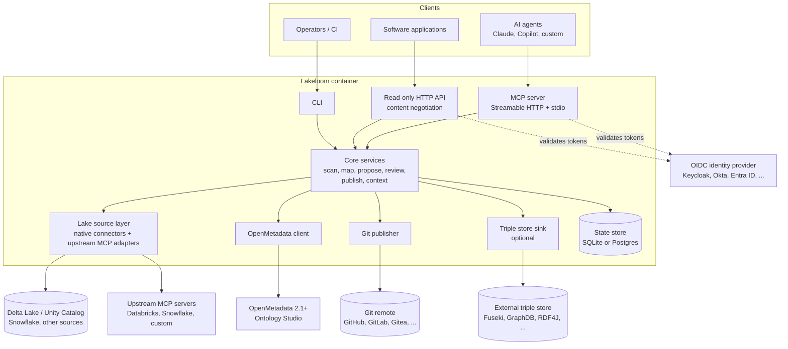

# Lakeloom

> **Status: pre-alpha (milestone M0).** Not ready for production use.

Lakeloom is an open-source, agent-first service that lets AI agents and domain specialists build
and maintain **business ontologies for the data products in a Delta Lake** (and other
lakehouse/warehouse platforms).

- **OpenMetadata Ontology Studio is the ontology engine.** It stores concepts, relationships,
  attributes, axioms and mappings, and governs changes through change sets that a reviewer applies.
- **Lakeloom is the link** between the lake and that engine. It reads schemas and table metadata,
  turns them into proposed ontology changes, and serves the resulting semantics back to agents and
  applications.
- **Git is the version store.** Every applied change and release is written to a Git repository in
  standard semantic formats.
- **There is no UI.** The interface is an MCP server (for agents), a small read-only HTTP API (for
  software), and a CLI (for operators and CI).

## Architecture

## Quick start

_Coming soon: docker compose quick start (added in milestone M0, task 10)._

For development setup see [CONTRIBUTING.md](CONTRIBUTING.md).

## Project documents

[Contributing](CONTRIBUTING.md) · [Code of Conduct](CODE_OF_CONDUCT.md) ·
[Security](SECURITY.md) · [Governance](GOVERNANCE.md) · [Changelog](CHANGELOG.md)

## Disclaimer

Lakeloom is an **independent project**. It is not affiliated with, endorsed by, or sponsored by
OpenMetadata, Collate, Databricks or Snowflake. All trademarks belong to their respective owners.

## License

Apache License 2.0. See [LICENSE](LICENSE) and [NOTICE](NOTICE).
