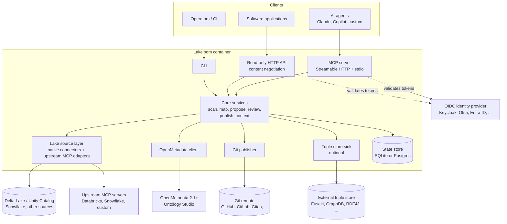

# Lakeloom

> **Status: pre-alpha (milestone M0).** Not ready for production use.

Lakeloom is an open-source, agent-first service that lets AI agents and domain specialists build
and maintain **business ontologies for the data products in a Delta Lake** (and other
lakehouse/warehouse platforms).

- **OpenMetadata Ontology Studio is the ontology engine.** It stores concepts, relationships,
  attributes, axioms and mappings, and governs changes through change sets that a reviewer applies.
- **Lakeloom is the link** between the lake and that engine. It reads schemas and table metadata,
  turns them into proposed ontology changes, and serves the resulting semantics back to agents and
  applications.
- **Git is the version store.** Every applied change and release is written to a Git repository in
  standard semantic formats.
- **There is no UI.** The interface is an MCP server (for agents), a small read-only HTTP API (for
  software), and a CLI (for operators and CI).

## Architecture



## Quick start

Runs the full development stack locally: OpenMetadata 2.1.0-rc1 (M0 targets this release
candidate), Keycloak, Gitea, PostgreSQL and Lakeloom.

**Prerequisites:** a Docker-compatible engine with at least 8 GB of memory (Docker Engine,
OrbStack, Podman or Rancher Desktop) and [uv](https://docs.astral.sh/uv/) (only needed for
development and the tests).

```bash
git clone https://github.com/elcioabrahao/lakeloom
cd lakeloom
docker compose -f deploy/compose/docker-compose.yml up -d --wait   # first start takes several minutes
curl localhost:8000/readyz
```

`/readyz` returns HTTP 200 once Lakeloom can reach OpenMetadata, its database and its Git workspace.

| Service       | URL                     | Notes                  |
|---------------|-------------------------|------------------------|
| Lakeloom      | http://localhost:8000   | MCP at `/mcp`          |
| OpenMetadata  | http://localhost:8585   |                        |
| Keycloak      | http://localhost:8180   | realm `lakeloom`       |
| Gitea         | http://localhost:3000   |                        |
| PostgreSQL    | localhost:5432          |                        |

All ports are bound to `127.0.0.1` only.

> **Development only.** Every credential in the dev stack is a fixed, publicly known default
> (for example the Keycloak client secret `dev-agent-secret` and the OpenMetadata admin
> `admin@open-metadata.org` / `admin`). Never reuse them outside a local machine.

### Call a tool from an agent

Get an agent token from Keycloak (client `lakeloom-agent`, realm `lakeloom`):

```bash
TOKEN=$(curl -s http://localhost:8180/realms/lakeloom/protocol/openid-connect/token \
  -d grant_type=client_credentials -d client_id=lakeloom-agent \
  -d client_secret=dev-agent-secret | python3 -c 'import sys, json; print(json.load(sys.stdin)["access_token"])')
```

Register Lakeloom in Claude Code and ask it to call `get_server_info` (or `list_sources`):

```bash
claude mcp add --transport http lakeloom http://localhost:8000/mcp \
  --header "Authorization: Bearer $TOKEN"
```

Any other MCP client that supports Streamable HTTP works the same way: point it at
`http://localhost:8000/mcp` and send the bearer token. Tokens are short-lived; fetch a new one
when it expires.

### Lake sources and scans

Lake sources are configured by the operator in a YAML file named by `LAKELOOM_CONFIG_FILE`;
agents can only name a configured source, never add one or pass a URL. The dev stack mounts
[`deploy/compose/lakeloom-sources.yaml`](deploy/compose/lakeloom-sources.yaml) with three
sources over the same fixture lake (catalog `retail`, schema `sales`, four tables):

```yaml
sources:
  - type: delta                       # Delta tables read with delta-rs (extra `delta`)
    name: fixture_delta
    om_service: lakeloom_fixture      # OpenMetadata service used to look tables up
    tables:
      - {uri: "file:///lake/orders", catalog: retail, schema: sales}
      # ... customers, products, invoices
  - type: unity_catalog               # Unity Catalog REST API (OSS or Databricks)
    name: fixture_uc
    url: http://unitycatalog:8080
    catalogs: [retail]                # optional allow-list
    read_storage: true                # versions/profiles from the Delta log
    om_service: lakeloom_fixture
  - type: mcp                         # an upstream MCP server, bound by a mapping file
    name: openmetadata_mcp
    transport: streamable_http
    url: http://openmetadata-server:8585/mcp
    token_file: /secrets/om_bot_token # or token_env: VAR_NAME; never logged
    mapping: /etc/lakeloom/mappings/openmetadata.yaml
    om_service: lakeloom_fixture
```

Relative `mapping` and `token_file` paths resolve against the YAML file's directory. A
broken config stops startup with a configuration error; an unreachable upstream MCP server
does not: its source is reported `available: false` with an error code and hint.

MCP tools: `list_sources`, `list_tables` (paginated with `cursor`/`limit`) and
`describe_table` need scope `lakeloom:read` and are read-only; `scan_lake_source` needs
`lakeloom:propose` and writes a scan record (tables, versions, OpenMetadata matches and
optional profiles). The same operations are on the CLI for operators:

```bash
docker compose -f deploy/compose/docker-compose.yml exec lakeloom lakeloom sources
docker compose -f deploy/compose/docker-compose.yml exec lakeloom lakeloom tables fixture_uc
docker compose -f deploy/compose/docker-compose.yml exec lakeloom lakeloom scan fixture_delta --profile
```

**Privacy defaults.** Profiles are computed where the data lives; no data is exported.
Sample values (min/max, top-k) are off by default (`LAKELOOM_PROFILE_SAMPLES=false`); when
enabled, columns tagged with a sensitive tag (`LAKELOOM_SENSITIVE_TAGS`, default `PII.*`)
never yield values, and values are truncated to `LAKELOOM_PROFILE_VALUE_MAX_LENGTH`
(default 64). Upstream MCP sources contribute aggregates only. Lake comments and upstream
text are untrusted: tool outputs show them as quoted blocks flagged `untrusted`.

Unity Catalog OSS keeps its state inside its container, so recreating the container drops
the fixture registrations; re-seed them with
`docker compose -f deploy/compose/docker-compose.yml run --rm uc-init`.

### Optional RDF store

```bash
RDF_ENABLED=true docker compose -f deploy/compose/docker-compose.yml --profile rdf up -d --wait
```

Stop the stack and delete its data with `docker compose -f deploy/compose/docker-compose.yml down -v`.

For development setup see [CONTRIBUTING.md](CONTRIBUTING.md).

## Project documents

[Contributing](CONTRIBUTING.md) · [Code of Conduct](CODE_OF_CONDUCT.md) ·
[Security](SECURITY.md) · [Governance](GOVERNANCE.md) · [Changelog](CHANGELOG.md)

## Disclaimer

Lakeloom is an **independent project**. It is not affiliated with, endorsed by, or sponsored by
OpenMetadata, Collate, Databricks or Snowflake. All trademarks belong to their respective owners.

## License

Apache License 2.0. See [LICENSE](LICENSE) and [NOTICE](NOTICE).
