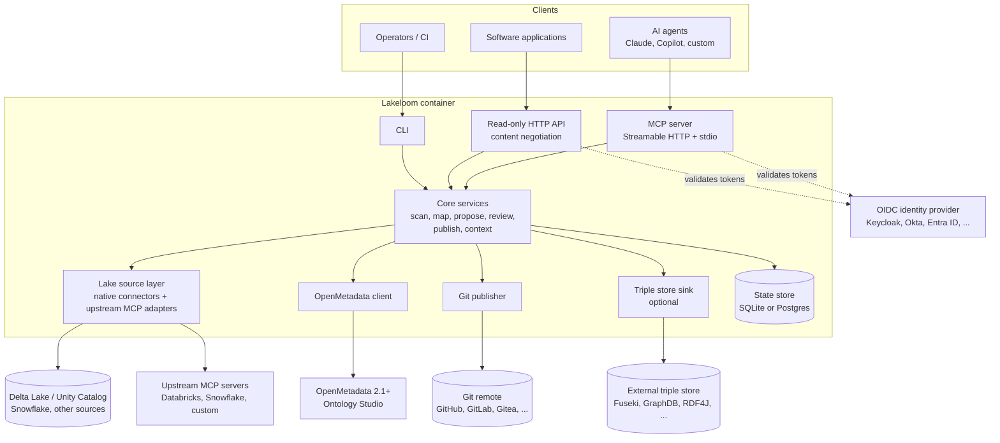

# Lakeloom — Requirements Specification

> **Audience:** Claude Code (and human contributors) implementing Lakeloom from scratch.
> **Status:** v0.1 draft, 2026-11-08. Owner: Elcio Abrahão.
> **Licence of the project:** Apache-2.0.

---

## 0. How to use this document (instructions for Claude Code)

1. Read the whole document before writing code. Section 13 (milestones) defines the build order; do not jump ahead.
2. Requirement IDs (`FR-…`, `NFR-…`) are stable. Reference them in commit messages, PR descriptions, docstrings of the implementing module, and test names (e.g. `test_fr_git_03_deterministic_serialization`).
3. Keywords **MUST / SHOULD / MAY** follow RFC 2119.
4. **Verify external APIs before coding against them.** OpenMetadata endpoint paths in this document come from the OpenMetadata **2.1 snapshot documentation**; Ontology Studio first ships in OpenMetadata 2.1 (2.1.0-rc1 was published 2026-10-28). Before implementing the OpenMetadata client, start an OpenMetadata 2.1 container, download its OpenAPI spec, and generate or hand-write the client from that spec. Where the spec differs from this document, the spec wins; record the difference in `docs/decisions/`.
5. **Do not invent tool names of third-party MCP servers** (Databricks, Snowflake, etc.). Discover them at runtime with `tools/list` and map them through configuration (FR-SRC-05).
6. When a requirement is ambiguous, choose the simplest option that satisfies it, write an Architecture Decision Record (ADR) in `docs/decisions/NNNN-title.md`, and continue. Open questions with default answers are listed in section 14.
7. Keep the system **agent-first**: every capability must be reachable through MCP tools. Do not build a web UI.

---

## 1. Summary

Lakeloom is an open-source, agent-first service that lets AI agents and domain specialists build and maintain **business ontologies for the data products in a Delta Lake** (and other lakehouse/warehouse platforms).

- **OpenMetadata Ontology Studio is the ontology engine.** It stores concepts, relationships, attributes, axioms and mappings, and governs changes through *change sets* that a reviewer applies.
- **Lakeloom is the link** between the lake and that engine. It reads schemas and table metadata (through its own connectors or by reusing existing MCP servers such as Databricks' or Snowflake's), turns them into proposed ontology changes, and serves the resulting semantics back to agents and applications.
- **Git is the version store.** Every applied change and every release is written to a Git repository in standard semantic formats.
- **There is no UI.** The interface is an MCP server (for agents), a small read-only HTTP API (for software), and a CLI (for operators and CI).

---

## 2. Goals and non-goals

### 2.1 Goals

| ID | Goal |
| --- | --- |
| G-1 | Bootstrap and evolve an ontology from lake metadata with minimal manual modelling. |
| G-2 | Keep humans in control: no ontology change is applied without an authorised human approval (unless an explicit auto-approve policy covers it). |
| G-3 | Give every data asset in the lake machine-readable business context (what a table/column *means*). |
| G-4 | Publish the ontology in open semantic formats for agents and software, with full version history in Git. |
| G-5 | Run anywhere as a container, with enterprise SSO/OAuth, as an Apache-2.0 GitHub project. |

### 2.2 Non-goals

- A graphical editor or web UI of any kind (OpenMetadata's own UI may still be used by people who want it, but Lakeloom MUST NOT depend on it).
- Replacing OpenMetadata's catalog, ingestion, lineage or data-quality features.
- Embedding an LLM. Lakeloom provides deterministic tools; the *calling agent* does the language reasoning (see FR-PRO-04 for the optional exception).
- Moving or copying lake **data**. Lakeloom handles metadata and aggregate profiles only.
- Being a general-purpose triple store or SPARQL engine.

---

## 3. Glossary

| Term | Meaning in this document |
| --- | --- |
| **OM** | OpenMetadata (≥ 2.1), the engine. |
| **Ontology model** | An OM glossary used as an ontology (`owl:Ontology` / `skos:ConceptScheme`). |
| **Concept** | An OM glossary term viewed as an ontology class/concept. |
| **Change set** | OM's unit of governed ontology change. States: `Draft → Submitted → Applied` (or `Apply Failed`, `Discarded`). Operations are typed and carry the base version of the entity they modify. |
| **Realization** | The link between a concept and the data assets (tables, columns) that carry it, i.e. glossary terms assigned to assets. |
| **Data product** | A set of lake tables published and owned as a unit. |
| **Lake source** | Any system Lakeloom reads lake metadata from: a native connector or an upstream MCP server. |
| **Proposal** | A Lakeloom-created OM change set plus Lakeloom provenance. |
| **Release** | A named, immutable, tagged version of an ontology model in Git. |
| **Agent principal** | A non-human identity (OAuth client) used by an AI agent. |
| **Human principal** | A person authenticated through SSO. |

---

## 4. Architecture

### 4.1 Context diagram



### 4.2 Systems of record

| Information | System of record | Notes |
| --- | --- | --- |
| Working ontology (current state, drafts, reviews) | **OpenMetadata** | Lakeloom never keeps a competing copy of live ontology state. |
| Released and historical ontology versions | **Git** | One commit per applied change set; one tag per release. |
| Lake schemas, table metadata | **The lake source** (Unity Catalog, Delta log, Snowflake, …) | Also often ingested into OM by OM's own connectors; Lakeloom SHOULD read from OM when the asset is already there (FR-SRC-07). |
| Proposal provenance (evidence, scan IDs, Delta versions) | **Lakeloom state store**, mirrored into the OM change set description and Git commit trailers | So provenance survives the loss of any one store. |
| Identities and groups | **The OIDC identity provider** | Shared by Lakeloom and OM. |

### 4.3 Main flows

1. **Scan → propose.** An agent calls `scan_lake_source` → Lakeloom reads metadata and profiles → `propose_from_scan` runs the deterministic mapper (section 6.3) → Lakeloom creates an OM change set in `Draft`, attaches provenance, and returns a human-readable summary.
2. **Enrich.** The agent searches for existing concepts (`find_concepts`), adds definitions, merges duplicates and adds relationships with `propose_change` (still in the same draft).
3. **Submit and review.** The agent calls `submit_proposal`. A human, talking to an agent, inspects it with `get_proposal` / `diff_proposal` and decides with `review_proposal`. Approval MUST be executed with the human's own identity (section 8.3).
4. **Apply → version.** On `Applied`, Lakeloom exports the ontology model from OM, serialises it deterministically, and commits it to Git (FR-GIT-*).
5. **Release → publish.** `create_release` tags a version in Git, regenerates published artefacts (Turtle, JSON-LD, SHACL, JSON-LD context), and optionally pushes to a triple store.
6. **Consume.** Agents call `get_asset_context` or read MCP resources; applications call the HTTP API.

---

## 5. Technology constraints

| ID | Constraint |
| --- | --- |
| TC-1 | Language: **Python ≥ 3.12**. No other runtime language in the service. |
| TC-2 | Packaging and environments: **uv**. Lint/format: **ruff**. Type checking: **pyright** (strict for `src/`). Tests: **pytest**. |
| TC-3 | MCP: the official **MCP Python SDK** (`mcp`), supporting Streamable HTTP and stdio transports. |
| TC-4 | HTTP: **FastAPI** (or Starlette) + **uvicorn**; outbound HTTP via **httpx** (async). |
| TC-5 | Data models: **pydantic v2**; settings via **pydantic-settings**. |
| TC-6 | RDF: **rdflib** for parsing/serialising; **pyshacl** for SHACL validation. pyoxigraph MAY be used for performance-critical paths. |
| TC-7 | Delta Lake without Databricks: **deltalake** (delta-rs Python bindings). Databricks: **databricks-sdk**. Snowflake: **snowflake-connector-python**. Each connector is an optional extra (`pip install lakeloom[databricks]`). |
| TC-8 | Git: the `git` CLI invoked via subprocess (preferred for reliability) or **GitPython**; forge APIs (GitHub/GitLab) via httpx. |
| TC-9 | Persistence: **SQLAlchemy 2** with SQLite (default) or PostgreSQL; migrations with **Alembic**. |
| TC-10 | Observability: **OpenTelemetry** SDK; structured JSON logging (stdlib `logging` + a JSON formatter). |
| TC-11 | No cloud-provider SDK may be a hard dependency (see NFR-DEP-02). |

---

## 6. Functional requirements

### 6.1 Lake sources (FR-SRC)

| ID | Level | Requirement |
| --- | --- | --- |
| FR-SRC-01 | MUST | Define a `LakeSource` interface with at least: `list_catalogs`, `list_schemas`, `list_tables`, `describe_table` (columns, types, nullability, comments, tags, partitioning, constraints), `get_table_version` (e.g. Delta version + commit timestamp), `profile_table` (optional capability). |
| FR-SRC-02 | MUST | Native connector for **Unity Catalog** (Databricks-hosted, and open-source Unity Catalog where its REST API is compatible), including table/column comments, tags, owners, primary/foreign key constraints where declared. |
| FR-SRC-03 | MUST | Native connector for **Delta tables on object storage** using `deltalake`: schema from the transaction log, column metadata, table properties, current version and commit time. Storage URIs: `s3://`, `abfss://`, `gs://`, `file://`. |
| FR-SRC-04 | SHOULD | Native connector for **Snowflake** using `INFORMATION_SCHEMA` / `ACCOUNT_USAGE` views. |
| FR-SRC-05 | MUST | **Upstream MCP adapter.** Lakeloom acts as an MCP *client* to one or more configured upstream MCP servers (stdio or Streamable HTTP). A declarative YAML mapping binds upstream tools to `LakeSource` operations (tool name, argument template, JSONPath/JMESPath result mapping). Tool names are discovered with `tools/list`; nothing is hard-coded. Ship example mappings for Databricks and Snowflake MCP servers marked as *examples to verify*. |
| FR-SRC-06 | MUST | Custom sources are added as Python plugins via entry points (`lakeloom.sources`). |
| FR-SRC-07 | SHOULD | If an asset already exists in OM (ingested by OM's own connectors), Lakeloom MUST use OM's fully qualified name (FQN) and entity ID for it, and SHOULD prefer OM's metadata, using its own connector only for what OM lacks (e.g. Delta version, profiles). |
| FR-SRC-08 | MUST | **Profiling** (when the source supports it): row count, null rate, distinct count, min/max for orderable types, top-k values for low-cardinality columns. Profiles MUST be computed where the data lives (SQL pushdown or delta-rs scans), never by exporting data. |
| FR-SRC-09 | MUST | **Privacy controls for profiles:** sample values are OFF by default; when enabled, values from columns tagged as sensitive (configurable tag list, e.g. `PII.*`) MUST be excluded; top-k values MUST be truncated to a configurable length. |
| FR-SRC-10 | MUST | Every scan produces a **scan record** (ID, source, tables, table versions, timestamp, principal) stored in the state store and referenced by any proposal built from it. |

### 6.2 OpenMetadata integration (FR-OM)

| ID | Level | Requirement |
| --- | --- | --- |
| FR-OM-01 | MUST | Async OM client covering: glossaries (ontology models) and their ontology configuration (base IRI, IRI minting pattern, prefixes, imports, layer); glossary terms (concepts); relationship types; attributes; axioms (`/api/v1/ontologyAxioms`, incl. `/validate`); concept mappings; change sets (`/api/v1/ontologyChangeSets`: create, add operations, undo/redo, submit, apply, discard); IRI preview (`/api/v1/ontology/modeling/iris/preview`); ontology import and export (`/api/v1/glossaries/{id}/exportOntology?format=…` and the import endpoint); glossary-scoped SPARQL (`POST /api/v1/glossaries/{id}/sparql`); RDF status (`GET /api/v1/rdf/status`); asset lookups (tables, columns, tags, owners, glossary-term assignments). *Paths to be verified against the OpenAPI spec — see §0.4.* |
| FR-OM-02 | MUST | All ontology **writes** go through change sets. Lakeloom MUST NOT bypass change sets for concepts, relations, attributes, axioms or mappings. |
| FR-OM-03 | MUST | Respect OM optimistic concurrency: if applying a change set fails because a base version is stale, surface a clear `conflict` error with the affected entities and offer `rebase_proposal` (rebuild the draft against current versions). |
| FR-OM-04 | MUST | Acquire and renew OM **editing leases** (`/api/v1/ontologyEditLocks`) when an operation requires one; release them on completion or error. |
| FR-OM-05 | MUST | Support OM authentication with (a) a **bot JWT** for agent principals and (b) **on-behalf-of user tokens** for human principals (section 8.3). |
| FR-OM-06 | SHOULD | Detect OM capabilities at startup (version, RDF enabled, OWL strict profile, AI mode) and expose them via `get_server_info`. Features that need RDF in OM MUST degrade gracefully when it is off. |
| FR-OM-07 | MAY | Proxy OM's AI suggestion endpoints (`/api/v1/ontology/ai/…`) as optional tools when OM's AI mode is enabled. |
| FR-OM-08 | MUST | Contract tests run against a real OM 2.1 container in CI (section 12). |

### 6.3 Proposals: from lake metadata to ontology changes (FR-PRO)

| ID | Level | Requirement |
| --- | --- | --- |
| FR-PRO-01 | MUST | **Deterministic mapper.** From a scan record, produce candidate operations using these default rules (configurable per ontology model): |

| Lake element | Default proposed ontology element |
| --- | --- |
| Table / data-product entity | Concept (`owl:Class`) |
| Column | Attribute (`owl:DatatypeProperty`) with data type mapped from the column type |
| Declared foreign key | Relationship (`owl:ObjectProperty`) with domain and range |
| Declared primary key | Attribute flagged `isIdentifier` (and `owl:hasKey` axiom if supported by OM) |
| Low-cardinality string column (threshold configurable) | `ENUM` attribute, or child concepts if configured |
| Table/column comment | Concept/attribute description |
| Tags | Kept as hints in provenance; not converted to concepts automatically |

| ID | Level | Requirement |
| --- | --- | --- |
| FR-PRO-02 | MUST | **Duplicate avoidance.** Before proposing a new concept or attribute, search existing concepts (name, synonyms, normalised local name, IRI) across the target model and its imports; when a likely match exists, propose a *link/realization* or *synonym* instead of a new concept, and report the match with a confidence score. |
| FR-PRO-03 | MUST | Every proposal stores **provenance**: scan ID, source table FQN, Delta/table version, rule IDs that produced each operation, calling principal, client name, timestamp. Provenance is written to (a) the state store, (b) the OM change set description (machine-readable block), and (c) the Git commit trailers when applied. |
| FR-PRO-04 | MAY | Optional LLM-backed enrichment *inside* Lakeloom (e.g. for batch jobs without an agent). If implemented, it MUST be off by default, provider-agnostic, and label all generated content as AI-generated in provenance. |
| FR-PRO-05 | MUST | `propose_change` accepts typed operations (add/update/remove concept, relation, attribute, axiom, mapping, realization) validated with pydantic before calling OM. Axioms MUST be validated with OM's `/validate` before being added. |
| FR-PRO-06 | MUST | Proposals produce a **plain-language summary** (Markdown) suitable for showing to a domain specialist: what will be added/changed/removed, why (evidence), and warnings. |
| FR-PRO-07 | SHOULD | **Drift detection.** `detect_drift` compares current lake metadata with the last scan used for a model and proposes changes for added/removed/renamed columns and tables. |
| FR-PRO-08 | SHOULD | Proposals are size-limited (configurable, default 50 operations) to keep reviews manageable; larger scans are split by table or data product. |

### 6.4 Review and approval (FR-REV)

| ID | Level | Requirement |
| --- | --- | --- |
| FR-REV-01 | MUST | Only **human principals** with the `lakeloom:review` scope AND reviewer permission in OM may approve (apply) or reject a proposal. Agent principals MUST be refused with an explicit error. |
| FR-REV-02 | MUST | Approval executes against OM **with the human's identity** (token exchange or delegated token, section 8.3), so OM's audit trail records the real approver. |
| FR-REV-03 | MUST | `review_proposal` supports `approve`, `reject` (reason required) and `request_changes` (comment required). Rejections and comments are stored in provenance. |
| FR-REV-04 | SHOULD | **Auto-approve policies** (off by default), declared in configuration per model, e.g. "add enum values observed in data", "fix description typos". Auto-approved changes are applied by a dedicated service principal and flagged `auto_approved` in provenance and Git. |
| FR-REV-05 | SHOULD | `list_pending_reviews` returns proposals awaiting the calling user, grouped by ontology model and data product. |

### 6.5 Git versioning (FR-GIT)

| ID | Level | Requirement |
| --- | --- | --- |
| FR-GIT-01 | MUST | One configured Git remote per Lakeloom instance (multiple models in one repo). Authentication via SSH key or HTTPS token supplied as a secret. |
| FR-GIT-02 | MUST | Repository layout: |

```
ontologies/
  <model-slug>/
    ontology.ttl          # canonical Turtle of the OM ontology model (OWL + SKOS)
    ontology.jsonld       # JSON-LD
    ontology.owl          # RDF/XML
    shapes.ttl            # SHACL shapes generated from attributes/relations (FR-PUB-04)
    context.jsonld        # JSON-LD @context for application use (FR-PUB-05)
    manifest.yaml         # OM glossary id, OM version, base IRI, layer, imports,
                          # last change set id, release version, source table versions
    CHANGELOG.md          # human-readable, generated from proposal summaries
provenance/
  <model-slug>.jsonl      # append-only provenance records
README.md                 # generated index of models and releases
```

| ID | Level | Requirement |
| --- | --- | --- |
| FR-GIT-03 | MUST | **Deterministic serialisation:** the same ontology state MUST produce byte-identical files (stable prefix order, sorted subjects/predicates/objects, canonical blank-node labelling, LF line endings, UTF-8). Covered by property-based tests. |
| FR-GIT-04 | MUST | On every `Applied` change set: export the model from OM, serialise, commit with message `ontology(<model>): <summary>` and trailers `Lakeloom-ChangeSet: <id>`, `Lakeloom-Proposal: <id>`, `Approved-By: <user>`, `Lake-Source-Version: <fqn>@<version>` (one per table). |
| FR-GIT-05 | MUST | Two publishing modes, configurable per model: `direct` (push to a branch) and `pull_request` (push a branch and open a PR/MR via the GitHub or GitLab API). |
| FR-GIT-06 | MUST | `create_release` creates an annotated tag `<model-slug>/v<semver>` and updates `manifest.yaml` and `CHANGELOG.md`. Version bump rules: removals or IRI changes → major; additions → minor; descriptions/labels only → patch (overridable). |
| FR-GIT-07 | MUST | **Restore/bootstrap:** `import_from_git` loads a model version from Git into OM (through import, producing a change set for review). |
| FR-GIT-08 | SHOULD | **Reconciliation job:** periodically compare OM state with the last Git commit and report drift caused by edits made directly in OM's UI; optionally commit them with trailer `Lakeloom-Origin: om-direct-edit`. |
| FR-GIT-09 | MUST | Git operations are serialised per repository (lock) and retried on transient failures; a failed push MUST NOT lose the commit (it stays queued in the state store). |

### 6.6 Import and export of semantic formats (FR-IO)

| ID | Level | Requirement |
| --- | --- | --- |
| FR-IO-01 | MUST | Export any model (current or a release) as **Turtle, RDF/XML (OWL), N-Triples, JSON-LD and SKOS**. Prefer OM's export endpoint; post-process for determinism. |
| FR-IO-02 | MUST | Import **OWL (RDF/XML), Turtle, N-Triples, JSON-LD, SKOS** files into a model via OM import, always as a reviewable change set (dry run first, reporting what would be added). |
| FR-IO-03 | SHOULD | Import **CSV** glossaries (OM-compatible format) and **LinkML** YAML (via LinkML's OWL generator) as change sets. |
| FR-IO-04 | MUST | Inputs are parsed and validated with rdflib before being sent to OM; parse errors return line/column information. |
| FR-IO-05 | MUST | Size limits on imports (configurable, default 20 MB) and a timeout. |

### 6.7 Asset context (FR-CTX)

| ID | Level | Requirement |
| --- | --- | --- |
| FR-CTX-01 | MUST | `get_asset_context(asset)` (asset = OM FQN, Unity Catalog name or storage URI) returns: the concepts realized by the table and each column; their definitions, synonyms, IRIs and parent concepts; relationships to other concepts and the tables that realize those; attribute data types, units and allowed values; owners and domain; data product; the ontology model and release version; known lineage neighbours (from OM). |
| FR-CTX-02 | MUST | Output formats: **Markdown** optimised for LLM context windows (default), **JSON** (pydantic schema published in the docs), and **JSON-LD** using the model's `context.jsonld`. |
| FR-CTX-03 | MUST | `explain_concept(concept)` returns a concept's definition, hierarchy, relations, attributes, mappings to external standards and realizing assets. |
| FR-CTX-04 | SHOULD | `find_assets_for_concept(concept)` returns all tables/columns realizing a concept (and its sub-concepts when `include_descendants=true`). |
| FR-CTX-05 | MUST | `propose_realization` links columns/tables to concepts (assigns glossary terms to assets in OM). Because this changes the catalog, it follows the same review rules as ontology changes (FR-REV-01). |
| FR-CTX-06 | SHOULD | Responses carry a `token_estimate` and support `max_tokens` truncation with explicit `truncated: true`. |
| FR-CTX-07 | MAY | Write-back of approved concept descriptions to Unity Catalog column/table comments and tags (opt-in per model). |

### 6.8 Publication for agents and software (FR-PUB)

| ID | Level | Requirement |
| --- | --- | --- |
| FR-PUB-01 | MUST | **MCP resources:** `lakeloom://models` (list), `lakeloom://models/{slug}/ontology.{ext}` (ext = `ttl`, `jsonld`, `owl`, `nt`), `lakeloom://models/{slug}/shapes.ttl`, `lakeloom://models/{slug}/context.jsonld`, `lakeloom://assets/{fqn}/context.md`. Resources support release pinning (`?version=1.4.0`). |
| FR-PUB-02 | MUST | **Read-only HTTP API** with content negotiation (`Accept: text/turtle`, `application/ld+json`, `application/rdf+xml`, `application/n-triples`, `text/markdown`, `application/json`): `GET /v1/models`, `GET /v1/models/{slug}`, `GET /v1/models/{slug}/versions`, `GET /v1/models/{slug}/versions/{version}`, `GET /v1/models/{slug}/shapes`, `GET /v1/models/{slug}/context.jsonld`, `GET /v1/concepts/{iri-or-id}`, `GET /v1/assets/{fqn}/context`. Published (released) versions are served from Git; `latest` from OM. |
| FR-PUB-03 | SHOULD | `POST /v1/models/{slug}/sparql` — read-only SPARQL proxied to OM's glossary-scoped SPARQL (rejects updates). |
| FR-PUB-04 | SHOULD | Generate **SHACL** shapes from attributes (datatype, cardinality, enum values, identifier) and relationships (class constraints), usable to validate instance data or pipeline outputs. |
| FR-PUB-05 | SHOULD | Generate a **JSON-LD `@context`** per model so applications can emit JSON that maps to ontology IRIs. |
| FR-PUB-06 | MAY | **Dereferenceable IRIs:** when the model's base IRI points at Lakeloom, `GET {base}/{local}` redirects (303) to the concept description with content negotiation. |
| FR-PUB-07 | MUST | Every published artefact has an `ETag`, `Last-Modified`, and a `Link` header to the Git commit or tag it came from. |
| FR-PUB-08 | MUST | An **OpenAPI** spec is generated and published for the HTTP API. |

### 6.9 Triple store export (FR-TS) — optional module

> The owner is unsure this is needed. OM already projects its catalog and ontology into Apache Jena Fuseki when RDF is enabled, but that store is OM's internal index (catalog-wide queries are admin-only). An external sink is useful when other applications need a SPARQL endpoint they control. **Decision: implement as an optional module, disabled by default, in milestone M3 only if time allows.**

| ID | Level | Requirement |
| --- | --- | --- |
| FR-TS-01 | MAY | `TripleStoreSink` interface with an implementation for the **SPARQL 1.1 Graph Store HTTP Protocol** (works with Fuseki, GraphDB, RDF4J, Stardog and others). |
| FR-TS-02 | MAY | On release, replace the named graph `<{base-iri}release/{version}>` and update `<{base-iri}latest>`; optionally also load SHACL shapes into `<{base-iri}shapes>`. |
| FR-TS-03 | MAY | Sink configuration per model; credentials as secrets; failures retried and reported, never blocking the Git release. |

### 6.10 Agent-first interaction (FR-AGT)

| ID | Level | Requirement |
| --- | --- | --- |
| FR-AGT-01 | MUST | Every capability in sections 6.1–6.9 is reachable through an MCP tool (section 7) with a JSON schema, a precise description written for LLMs, and documented side effects. |
| FR-AGT-02 | MUST | Tool outputs are compact and structured: a short Markdown summary plus structured content. Lists are paginated (`cursor`, `limit`). |
| FR-AGT-03 | MUST | Destructive or catalog-changing tools require an explicit `confirm` token returned by a prior dry-run call (pattern: first call returns a preview and `confirm_token`; second call with the token executes). Tokens bind to the previewed state and expire (default 10 minutes). |
| FR-AGT-04 | MUST | MCP **prompts** ship with the server: `bootstrap_data_product` (scan → propose → enrich → submit), `review_with_specialist` (walk a human through pending proposals in plain language), `explain_table` (business context for a table), `drift_check`. |
| FR-AGT-05 | MUST | Errors are typed (`not_found`, `forbidden`, `conflict`, `validation_error`, `upstream_unavailable`, `rate_limited`) with an actionable `hint` for the agent. |
| FR-AGT-06 | SHOULD | Tool annotations (`readOnlyHint`, `destructiveHint`, `idempotentHint`) are set correctly for every tool. |
| FR-AGT-07 | MUST | A CLI (`lakeloom …`) exposes the same operations for operators and CI (e.g. `lakeloom scan`, `lakeloom export`, `lakeloom release`, `lakeloom serve`). |

---

## 7. MCP tool catalogue (initial)

Scopes are OAuth scopes (section 8.2). "OM write" means the tool creates or changes OM state.

| Tool | Purpose | Scope | Side effects |
| --- | --- | --- | --- |
| `get_server_info` | Versions, enabled features, OM capabilities, configured sources and models | `lakeloom:read` | none |
| `list_sources` / `list_tables` / `describe_table` | Browse lake metadata | `lakeloom:read` | none |
| `scan_lake_source` | Scan catalogs/schemas/tables (+ optional profiling); returns scan ID and summary | `lakeloom:propose` | scan record |
| `list_models` / `get_model` | Ontology models and their configuration | `lakeloom:read` | none |
| `create_model` | Create an ontology model (glossary) with base IRI, layer, imports | `lakeloom:admin` | OM write (via confirm) |
| `find_concepts` | Search concepts across models (name, synonym, IRI, fuzzy) | `lakeloom:read` | none |
| `explain_concept` | Full description of a concept | `lakeloom:read` | none |
| `propose_from_scan` | Run the deterministic mapper; create a draft change set | `lakeloom:propose` | OM draft change set |
| `propose_change` | Add typed operations to a draft | `lakeloom:propose` | OM draft change set |
| `propose_realization` | Link assets to concepts | `lakeloom:propose` | OM draft / pending task |
| `get_proposal` / `diff_proposal` | Plain-language and structured view of a proposal | `lakeloom:read` | none |
| `submit_proposal` | Submit draft for review | `lakeloom:propose` | OM change set → Submitted |
| `list_pending_reviews` | Proposals awaiting the caller | `lakeloom:review` | none |
| `review_proposal` | Approve / reject / request changes (human only) | `lakeloom:review` | OM apply/discard, Git commit |
| `rebase_proposal` | Rebuild a stale draft against current versions | `lakeloom:propose` | OM draft |
| `detect_drift` | Compare lake metadata to last scan and propose updates | `lakeloom:propose` | scan record, draft |
| `get_asset_context` | Business context for a table/column | `lakeloom:read` | none |
| `find_assets_for_concept` | Assets realizing a concept | `lakeloom:read` | none |
| `export_model` | Export in a semantic format (current or release) | `lakeloom:read` | none |
| `import_model` | Import a semantic file as a reviewable change set (dry run first) | `lakeloom:propose` | OM draft |
| `create_release` | Tag a release in Git and regenerate artefacts | `lakeloom:publish` | Git tag/commit, optional triple store |
| `list_releases` / `diff_releases` | Release history and semantic diff | `lakeloom:read` | none |
| `validate_model` | SHACL/axiom/consistency checks, isolated concepts, duplicate labels | `lakeloom:read` | none |
| `sparql_query` | Read-only SPARQL over a model (proxied to OM) | `lakeloom:read` | none |

---

## 8. Security, SSO and OAuth (NFR-SEC)

### 8.1 Authentication

| ID | Level | Requirement |
| --- | --- | --- |
| NFR-SEC-01 | MUST | Lakeloom is an **OAuth 2.1 resource server** for both MCP (Streamable HTTP) and the HTTP API. It validates JWT access tokens from a configured **OIDC** issuer (JWKS discovery, `iss`, `aud`, `exp`, `nbf` checks, clock-skew tolerance). Provider-agnostic: tested with **Keycloak**; documented for Okta, Microsoft Entra ID, Google, Auth0. |
| NFR-SEC-02 | MUST | Implement the **MCP authorization specification**: publish OAuth Protected Resource Metadata (RFC 9728) at `/.well-known/oauth-protected-resource`, return `401` with `WWW-Authenticate` pointing to it, and reject tokens not issued for Lakeloom's audience/resource indicator. |
| NFR-SEC-03 | MUST | **Agent principals** authenticate with OAuth **client credentials**; **human principals** with authorization code + PKCE via SSO (performed by the MCP client). Lakeloom distinguishes them by a configurable claim (default: presence of a `client_id`-only token vs a `sub` mapped to a user) and records the type in audit logs. |
| NFR-SEC-04 | MUST | stdio transport (local use) uses credentials from environment/config and is treated as the configured local principal; it MUST be disabled in container deployments unless explicitly enabled. |
| NFR-SEC-05 | MAY | Static API keys for development only, disabled by default and refused when `LAKELOOM_ENV=production`. |

### 8.2 Authorisation

| ID | Level | Requirement |
| --- | --- | --- |
| NFR-SEC-06 | MUST | Scopes: `lakeloom:read`, `lakeloom:propose`, `lakeloom:review`, `lakeloom:publish`, `lakeloom:admin`. Scope-to-group mapping is configurable (IdP groups → scopes). |
| NFR-SEC-07 | MUST | Per-model authorisation: models can restrict who may propose/review/publish (by group). OM permissions are still enforced downstream (defence in depth). |

### 8.3 Calling OpenMetadata on behalf of users

| ID | Level | Requirement |
| --- | --- | --- |
| NFR-SEC-08 | MUST | Preferred: **OAuth 2.0 Token Exchange (RFC 8693)** to obtain an OM-audience token for the human caller when the IdP supports it. |
| NFR-SEC-09 | MUST | Fallback: when OM and Lakeloom share the same OIDC provider and OM accepts the user's token audience, forward the user's token. |
| NFR-SEC-10 | MUST | If neither is possible, **human-only operations (review/approve) MUST fail closed** with a configuration error. Agent operations use the OM bot JWT. The bot token MUST NOT be used to approve. |

### 8.4 General

| ID | Level | Requirement |
| --- | --- | --- |
| NFR-SEC-11 | MUST | Secrets (OM bot JWT, Git credentials, source credentials, client secrets) come from environment variables or mounted files (`*_FILE` convention); never logged; never returned by tools. |
| NFR-SEC-12 | MUST | **Audit log** for every write and every review decision: principal, principal type, client, tool/endpoint, model, proposal/change set ID, result. JSON lines to stdout and to the state store. |
| NFR-SEC-13 | MUST | Upstream MCP servers and lake sources are configured by operators only; agents cannot add sources or arbitrary URLs at runtime (prevents SSRF and tool-injection). |
| NFR-SEC-14 | MUST | Treat text returned by upstream MCP servers, lake comments and imported files as **untrusted data**: never execute it, and mark it as quoted content in tool outputs. |
| NFR-SEC-15 | MUST | TLS is terminated by the deployment (ingress/reverse proxy) or by uvicorn when certificates are provided; CORS disabled by default. |
| NFR-SEC-16 | SHOULD | Rate limiting per principal (configurable) on MCP and HTTP. |
| NFR-SEC-17 | MUST | Dependency and container scanning in CI; `SECURITY.md` with a private disclosure process. |

---

## 9. Deployment and operations (NFR-DEP, NFR-OPS)

| ID | Level | Requirement |
| --- | --- | --- |
| NFR-DEP-01 | MUST | Ship one **OCI container image** (`ghcr.io/<org>/lakeloom`), multi-arch (`linux/amd64`, `linux/arm64`), non-root user, read-only root filesystem compatible, slim base image, SBOM attached. |
| NFR-DEP-02 | MUST | **Cloud-agnostic:** runs on any container runtime (Docker, Podman, Kubernetes, ECS, Azure Container Apps, Cloud Run, Nomad). No cloud-specific service is required; cloud SDKs are optional extras for connectors only. |
| NFR-DEP-03 | MUST | 12-factor configuration via environment variables (section 10), with an optional YAML file for sources, mappings and model policies. |
| NFR-DEP-04 | MUST | Volumes: `/data` (SQLite state store, Git working copy, caches). With PostgreSQL configured, only the Git working copy needs persistence (and can be re-cloned). |
| NFR-DEP-05 | MUST | `docker-compose.yml` example for local development: Lakeloom + OpenMetadata 2.1 stack (as published by the OM project) + Keycloak (pre-seeded realm, users, groups, clients) + Gitea (local Git remote) + optional Fuseki. |
| NFR-DEP-06 | SHOULD | **Helm chart** in `deploy/helm/lakeloom`. |
| NFR-DEP-07 | MUST | Horizontal scaling: the HTTP/MCP layer is stateless; background jobs (scans, Git pushes, reconciliation) use a lease in the state store so only one replica runs a given job. SQLite mode is single-replica only (documented). |
| NFR-OPS-01 | MUST | Health endpoints: `/healthz` (process up), `/readyz` (OM reachable, state store ready, Git workspace usable). |
| NFR-OPS-02 | MUST | OpenTelemetry traces and metrics (OTLP exporter, off unless configured); Prometheus `/metrics` endpoint. Key metrics: tool calls by name/outcome, OM latency, proposals by state, Git push failures, scan durations. |
| NFR-OPS-03 | MUST | Structured JSON logs with request/trace IDs; log level configurable. |
| NFR-OPS-04 | SHOULD | Graceful shutdown: finish in-flight tool calls (timeout), flush queued Git pushes to the state store. |

### Performance targets (initial)

| ID | Target |
| --- | --- |
| NFR-PERF-01 | Read tools (`get_asset_context`, `explain_concept`, `find_concepts`) p95 < 1.5 s with a warm cache and OM on the same network. |
| NFR-PERF-02 | `scan_lake_source` for 100 tables without profiling < 60 s (excluding source latency beyond Lakeloom's control). |
| NFR-PERF-03 | Ontology models up to 10,000 concepts and 50,000 relations export and serialise deterministically in < 30 s. |

---

## 10. Configuration (initial set)

| Variable | Default | Purpose |
| --- | --- | --- |
| `LAKELOOM_ENV` | `development` | `development` or `production` (stricter defaults). |
| `LAKELOOM_CONFIG_FILE` | — | Optional YAML for sources, MCP mappings, model policies. |
| `LAKELOOM_PUBLIC_URL` | — | External base URL (OAuth metadata, links, dereferenceable IRIs). |
| `LAKELOOM_OM_URL` | — | OpenMetadata base URL. |
| `LAKELOOM_OM_BOT_TOKEN` / `_FILE` | — | OM bot JWT for agent operations. |
| `LAKELOOM_OIDC_ISSUER` | — | OIDC issuer URL. |
| `LAKELOOM_OIDC_AUDIENCE` | `lakeloom` | Expected token audience. |
| `LAKELOOM_OIDC_TOKEN_EXCHANGE` | `true` | Use RFC 8693 for OM on-behalf-of calls. |
| `LAKELOOM_OIDC_CLIENT_ID` | — | Confidential client Lakeloom uses for the token exchange. |
| `LAKELOOM_OIDC_CLIENT_SECRET` / `_FILE` | — | Secret of that client (`client_secret_basic`). |
| `LAKELOOM_OIDC_TOKEN_ENDPOINT` | discovery | IdP token endpoint; default from the issuer's `/.well-known/openid-configuration`. |
| `LAKELOOM_OM_AUDIENCE` | `openmetadata` | `audience` requested in the exchange. |
| `LAKELOOM_OM_EXCHANGE_SCOPE` | unset | `scope` sent in the exchange when set (Keycloak 26: the client scope with the OM audience mapper; the dev stack sets `openmetadata-audience`); unset or empty omits the scope. |
| `LAKELOOM_OM_FORWARD_USER_TOKEN` | `false` | With exchange off, forward the caller's token to OM (OM must accept Lakeloom's audience). |
| `LAKELOOM_SCOPE_GROUP_MAP` | — | Mapping of IdP groups to scopes (JSON). |
| `LAKELOOM_DB_URL` | `sqlite:////data/lakeloom.db` | State store. |
| `LAKELOOM_GIT_REMOTE` | — | Git remote URL. |
| `LAKELOOM_GIT_BRANCH` | `main` | Target branch. |
| `LAKELOOM_GIT_MODE` | `pull_request` | `direct` or `pull_request`. |
| `LAKELOOM_GIT_SSH_KEY_FILE` / `LAKELOOM_GIT_TOKEN` / `_FILE` | — | Git credentials. |
| `LAKELOOM_FORGE` | `github` | `github`, `gitlab`, `gitea`, `none`. |
| `LAKELOOM_PROFILE_SAMPLES` | `false` | Allow sample values in profiles. |
| `LAKELOOM_SENSITIVE_TAGS` | `PII.*` | Tags whose columns never yield sample values. |
| `LAKELOOM_MAX_PROPOSAL_OPS` | `50` | Proposal size limit. |
| `LAKELOOM_TRIPLESTORE_ENABLED` | `false` | Enable FR-TS module. |
| `LAKELOOM_STDIO_ENABLED` | `false` in production | Allow stdio transport. |
| `LAKELOOM_OTEL_EXPORTER_OTLP_ENDPOINT` | — | Telemetry endpoint. |

---

## 11. Repository and open-source requirements (NFR-OSS)

| ID | Level | Requirement |
| --- | --- | --- |
| NFR-OSS-01 | MUST | Public GitHub repository, **Apache-2.0** licence (`LICENSE`, `NOTICE`), compatible with OpenMetadata's Apache-2.0 licence. |
| NFR-OSS-02 | MUST | `README.md` (what/why, quick start with docker compose, architecture diagram), `CONTRIBUTING.md`, `CODE_OF_CONDUCT.md` (Contributor Covenant), `SECURITY.md`, `CHANGELOG.md` (Keep a Changelog), `GOVERNANCE.md` (initial: maintainer-led). |
| NFR-OSS-03 | MUST | GitHub Actions: lint (ruff), type check (pyright), unit tests, contract tests against OM 2.1 + Keycloak in docker compose, container build and scan, SBOM, release workflow publishing the image to GHCR and the package to PyPI (`lakeloom`, name availability to be confirmed) with signed artefacts (Sigstore/cosign). |
| NFR-OSS-04 | MUST | Conventional Commits; semantic versioning of Lakeloom itself; DCO sign-off required on PRs. |
| NFR-OSS-05 | MUST | Documentation site source in `docs/` (MkDocs Material): concepts, deployment, security/SSO guides per IdP, MCP tool reference (generated from tool schemas), HTTP API reference (generated from OpenAPI), source connector guides, ADRs. |
| NFR-OSS-06 | SHOULD | Issue and PR templates; labels for `good first issue`, `connector`, `security`. |
| NFR-OSS-07 | MUST | README states clearly that Lakeloom is an independent project, not affiliated with OpenMetadata, Collate, Databricks or Snowflake; trademarks belong to their owners. |

### Proposed repository layout

```
lakeloom/
  src/lakeloom/
    __init__.py
    config.py                # pydantic-settings
    server/
      mcp_app.py             # MCP server, tool registration, prompts, resources
      http_app.py            # FastAPI read API, OAuth metadata, health, metrics
      auth.py                # OIDC validation, scopes, principal model, token exchange
    core/
      scans.py
      mapper.py              # deterministic mapping rules (FR-PRO-01)
      proposals.py
      reviews.py
      context.py             # asset context (FR-CTX)
      releases.py
      validation.py          # SHACL, duplicates, isolated concepts
    om/
      client.py              # generated/typed OM client
      models.py
    sources/
      base.py                # LakeSource protocol
      unity_catalog.py
      delta_storage.py
      snowflake.py
      mcp_adapter.py         # upstream MCP client + YAML mappings (FR-SRC-05)
    gitstore/
      repo.py
      serialize.py           # deterministic RDF serialisation (FR-GIT-03)
      forge.py               # GitHub/GitLab/Gitea PRs
    publish/
      formats.py
      shacl_gen.py
      jsonld_context.py
      triplestore.py         # optional (FR-TS)
    state/
      db.py
      migrations/
    cli.py
  tests/
    unit/
    contract/                # against real OM 2.1 + Keycloak containers
    e2e/
  deploy/
    docker/Dockerfile
    compose/docker-compose.yml
    compose/keycloak-realm.json
    helm/lakeloom/
  examples/
    mcp-mappings/databricks.example.yaml
    mcp-mappings/snowflake.example.yaml
    models/retail-demo/
  docs/
    decisions/
  pyproject.toml
  LICENSE  NOTICE  README.md  CONTRIBUTING.md  CODE_OF_CONDUCT.md  SECURITY.md  CHANGELOG.md
```

---

## 12. Testing strategy

| ID | Level | Requirement |
| --- | --- | --- |
| NFR-TST-01 | MUST | Unit tests for mapper rules, serialisation determinism (property-based with Hypothesis), auth/scopes, confirm-token logic, MCP mapping engine. Coverage target ≥ 85 % for `core/`, `gitstore/`, `server/auth.py`. |
| NFR-TST-02 | MUST | **Contract tests** against real containers: OM 2.1 (pinned image tag), Keycloak, Gitea. They exercise: create model, propose from a fixture scan, submit, approve as a human user (token exchange), Git commit content and trailers, release tag, export formats round-trip. |
| NFR-TST-03 | MUST | Fixture lake: a small set of Delta tables generated with `deltalake` in `tests/fixtures/` (orders, customers, products, invoices with FKs, comments and tags) so tests need no cloud account. |
| NFR-TST-04 | MUST | MCP conformance tests: every tool has a schema, description, annotations; error types match FR-AGT-05. |
| NFR-TST-05 | SHOULD | Security tests: invalid/expired tokens, wrong audience, agent attempting `review_proposal`, scope escalation, SSRF attempts via inputs. |
| NFR-TST-06 | SHOULD | An end-to-end "agent script" test that drives the MCP server with a scripted client through the `bootstrap_data_product` prompt flow. |

---

## 13. Milestones and acceptance criteria

| Milestone | Scope | Acceptance criteria |
| --- | --- | --- |
| **M0 — Foundations** | Repo skeleton, CI, licence and community files, config, container image, health/metrics, OIDC validation middleware, OM client generated from the OM 2.1 OpenAPI spec, docker compose with OM + Keycloak + Gitea. | `docker compose up` starts everything; `/readyz` green; CI green; a token from Keycloak is accepted and a wrong-audience token is rejected; `get_server_info` reports OM version and RDF status. |
| **M1 — Read path** | Delta storage + Unity Catalog connectors, upstream MCP adapter with one working mapping, scans and profiles with privacy controls, `get_asset_context`, `explain_concept`, `find_concepts`, `export_model`, MCP resources, HTTP read API. | On the fixture lake: scan returns all tables with versions; asset context for `orders` lists concepts realized by its columns (after fixture concepts are seeded); exports in all five formats parse with rdflib; outputs identical across two runs. |
| **M2 — Write path and governance** | Deterministic mapper, proposals as OM change sets with provenance, duplicate avoidance, review with human identity, confirm tokens, Git commit on apply (both modes), audit log. | `bootstrap_data_product` flow creates a model from the fixture lake; an agent principal cannot approve; a Keycloak user approves and OM records that user; Git contains the commit with all trailers; re-running the scan proposes no duplicates. |
| **M3 — Publication** | Releases and tags, CHANGELOG generation, SHACL and JSON-LD context generation, content negotiation, SPARQL proxy, import (OWL/Turtle/SKOS/JSON-LD) as change sets, drift detection, optional triple store sink. | Release `v1.0.0` produces tag and artefacts; importing an exported release into a fresh OM round-trips with no semantic diff; SHACL shapes validate fixture data; drift detection proposes changes after a fixture column is added. |
| **M4 — Hardening and first public release** | Snowflake connector, Databricks/Snowflake MCP mapping examples verified, Helm chart, rate limiting, reconciliation job, docs site, security review, `v0.1.0` on GHCR and PyPI. | All MUST requirements implemented or explicitly deferred by ADR; docs published; image signed; quick start works on a clean machine in < 15 minutes. |

---

## 14. Open questions (with default decisions)

| # | Question | Default until decided |
| --- | --- | --- |
| Q1 | Is the external triple store export (FR-TS) needed? | Optional module, disabled by default, built last in M3. |
| Q2 | Is OpenMetadata deployed and owned by another team, or shipped with Lakeloom? | Lakeloom assumes an **existing** OM ≥ 2.1; compose file includes OM for development only. |
| Q3 | Ontology Studio is new (first in OM 2.1, release candidate as of 2026-10-28). What if APIs change before GA? | Pin the OM image tag; isolate all OM calls in `om/`; contract tests gate upgrades. |
| Q4 | Should Lakeloom embed an LLM for batch enrichment? | No (FR-PRO-04 stays MAY). |
| Q5 | Git hosting and organisation name for the project and for ontology repositories? | Project: `github.com/<org>/lakeloom` (org TBD). Ontology repo: configurable. |
| Q6 | Approval policy: single reviewer or two-person rule for some models? | Single reviewer by default; per-model `min_approvals` setting reserved in config. |
| Q7 | Default base IRI pattern for new models? | `{LAKELOOM_PUBLIC_URL}/ontology/{model-slug}/` with OM `iriMintingPattern` `{term}`; must be settled before modelling at scale because changing it changes concept identities. |
| Q8 | Does OM's AI mode work in self-hosted OpenMetadata (config flag is named `RDF_ASK_COLLATE_ENABLED`)? | Not relied upon; FR-OM-07 remains MAY. |
| Q9 | Write-back to Unity Catalog comments/tags? | Opt-in per model (FR-CTX-07), not in M0–M3. |
| Q10 | PyPI and GitHub name availability for `lakeloom`. | Verify before M4; fall back to `lakeloom-mcp`. |

---

## 15. References

- OpenMetadata — Ontology & Knowledge Graph (2.1 snapshot docs): https://docs.open-metadata.org/v2.1.x-SNAPSHOT/how-to-guides/ontology
- Ontology Studio overview: https://docs.open-metadata.org/v2.1.x-SNAPSHOT/how-to-guides/ontology/studio
- Core concepts (concepts, relationship types, attributes, axioms, IRIs, layers): https://docs.open-metadata.org/v2.1.x-SNAPSHOT/how-to-guides/ontology/concepts
- Edit mode, change sets and APIs: https://docs.open-metadata.org/v2.1.x-SNAPSHOT/how-to-guides/ontology/studio/author
- Import & export formats: https://docs.open-metadata.org/v2.1.x-SNAPSHOT/how-to-guides/ontology/studio/import-export
- Enabling RDF / configuration reference: https://docs.open-metadata.org/v2.1.x-SNAPSHOT/how-to-guides/ontology/enable
- Ontology & KG MCP tools for AI agents: https://docs.open-metadata.org/v2.1.x-SNAPSHOT/how-to-guides/ontology/ai-agents
- OpenMetadata MCP server: https://docs.open-metadata.org/v2.1.x-SNAPSHOT/how-to-guides/mcp/connect
- OpenMetadata MCP in Databricks Unity Catalog: https://docs.open-metadata.org/v2.1.x-SNAPSHOT/how-to-guides/mcp/databricks
- Glossary approval workflow: https://docs.open-metadata.org/v2.1.x-SNAPSHOT/how-to-guides/data-governance/glossary/approval
- OpenMetadata releases: https://github.com/open-metadata/OpenMetadata/releases
- OpenMetadata licence (Apache-2.0): https://github.com/open-metadata/OpenMetadata/blob/main/LICENSE
- Model Context Protocol specification (incl. authorization): https://modelcontextprotocol.io/specification
- RFC 9728 OAuth 2.0 Protected Resource Metadata: https://www.rfc-editor.org/rfc/rfc9728
- RFC 8693 OAuth 2.0 Token Exchange: https://www.rfc-editor.org/rfc/rfc8693
- SPARQL 1.1 Graph Store HTTP Protocol: https://www.w3.org/TR/sparql11-http-rdf-update/
- delta-rs (Python `deltalake`): https://delta-io.github.io/delta-rs/
- rdflib: https://rdflib.readthedocs.io/ · pyshacl: https://github.com/RDFLib/pySHACL
